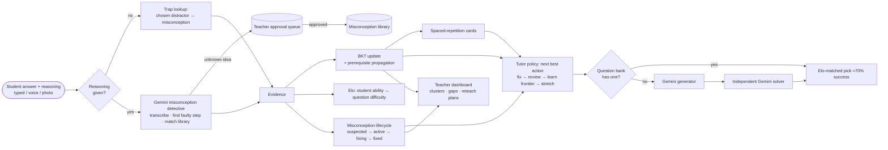

# समझ Samajh: the tutor that finds out *why* you got it wrong

**An adaptive exam-prep tutor with a learner model, for CBSE Class 10 Physics.**
Built in one day for the Product Space Agentic AI Hackathon (21 Nov 2026), problem statement 02.

> Most AI tutors check your final answer. Samajh reads **how you reasoned** (typed, spoken in Hinglish, or a photo of your handwritten rough work), finds the exact step where the reasoning breaks, names the misconception behind it, and keeps a live map of what you actually understand.

**Live demo:** _link added after deployment_ · **Try it in 30 seconds:** open the link, click **Explore as a demo student**, then **Teacher view**.

---

## The problem, as we understand it

"Generic AI tutors answer questions but don't track what a student actually understands." Three things make that gap expensive:

1. **Wrong answers have causes, and the causes repeat.** Physics-education research has catalogued the same faulty mental models for decades, for example the belief that a bulb *uses up* current (Shipstone 1984; McDermott & Shaffer 1992). A student who holds one will keep losing marks across several chapters until the *idea* is fixed. Re-explaining the topic doesn't fix it.
2. **Right answers can hide wrong reasoning.** A student who picks the correct option for the wrong reason looks fine on a score sheet and fails the next variant. Only the reasoning shows this.
3. **Concepts depend on each other.** A student struggling with *combined circuits* often has a gap in *Ohm's law* or *parallel resistors*. Practising the symptom wastes time; the tutor has to trace the root cause.

**Who it's for**
- **Student (Class 10, preparing for boards).** Wants to know what to study next and why they keep getting a type of question wrong. Often thinks in Hinglish and works on paper.
- **Teacher (40 students, one period).** Can't read every student's working. Needs to know which *ideas* are spreading in the class and how to reteach them in ten minutes.

---

## What we built, mapped to the brief

| The brief asks for | How Samajh does it |
|---|---|
| **A diagnostic test** | Ten **graph-adaptive** questions. Each pick is chosen from the last answer: a miss sends Samajh to probe that concept's prerequisites (root-cause search), a hit climbs to dependent concepts. Every pick shows its reason ("You missed X, so I'm checking its prerequisite Y"). |
| **A concept graph for one syllabus** | 31 concepts across Light, the Human Eye, Electricity and Magnetic Effects (rationalised CBSE syllabus), with 38 prerequisite links. Rendered as a live map where each concept is an ink well that fills with mastery. |
| **A learner model that updates mastery per concept after every answer** | **Bayesian Knowledge Tracing** per concept, then **evidence propagation** along prerequisite links (success pulls weaker prerequisites up, failure pulls stronger dependents down). The feedback screen shows every concept that moved. |
| **Question generation targeted at weak concepts, with difficulty calibration** | Gemini writes new questions for the weakest concept at a target difficulty, with **every wrong option tagged to the misconception it catches**. A **second, independent AI solves each question without the answer key**; it's only served if both agree. Every question carries an **Elo rating** that recalibrates from real answers, and Samajh serves the question you have a ~70% chance of getting right. |
| **Misconception detection from the reasoning, not just the wrong answer** | Students explain by **typing, speaking (Hindi/English/Hinglish) or photographing their working**. Gemini transcribes, quotes the faulty step, and maps it to a library of 34 documented misconceptions, including **right answer, wrong reasoning**. Without any reasoning, the misconception-tagged trap a student picks still flags a *suspected* misconception. |
| **Spaced-repetition scheduling** | Concepts that reach 70% mastery get SM-2-style review cards with a forgetting curve (predicted recall per day). Failed reviews pull the concept back. A "skip ahead 3 days" control demonstrates the decay. |
| **A teacher dashboard showing class-wide gaps** | Students are grouped by the **misconception they share**, not by marks. The dashboard ranks weakest concepts with their root-cause prerequisite, shows a student × concept heatmap, and has **one-click 10-minute reteach plans** (predict → observe → explain, with exit questions). |

**Beyond the brief: a library that grows, with a human in charge.** When a student's reasoning shows a faulty idea that isn't in the library, Gemini drafts a new entry. It goes to the teacher's queue, and only after approval does Samajh check every student for it.

---

## How the agent is put together



**Design principle: language and judgement go to the LLM; anything that has to be exact and auditable is done in code.** Gemini never computes mastery or schedules. It reads reasoning, writes questions and drafts lesson plans. The learner model, calibration and scheduling are deterministic, explainable and unit-testable. Every AI call has a deterministic fallback, so the product keeps working when the model is slow or rate-limited.

| Part | Where |
|---|---|
| Concept graph + misconception library | `src/lib/curriculum/` |
| BKT, propagation, Elo, spaced repetition | `src/lib/engine/learner.ts` |
| Diagnostic, question selection, next-best-action | `src/lib/engine/policy.ts` |
| One answer → full state transition | `src/lib/engine/apply.ts` |
| Gemini: reasoning analysis (multimodal) | `src/app/api/analyze/route.ts` |
| Gemini: question generator + verifier | `src/app/api/generate/route.ts` |
| Gemini: teacher reteach plans | `src/app/api/reteach/route.ts` |

---

## Run it locally

```bash
npm install
cp .env.example .env.local   # then paste your Gemini API key
npm run dev                  # http://localhost:3000
```

`GEMINI_API_KEY` is required for reasoning analysis, question generation and reteach plans. Without a key, the app still runs on its deterministic fallbacks.

**Models and resilience.** Calls go through a model chain, `gemini-3.5-flash-lite` → `gemini-2.5-flash` → `gemini-3.8-flash`, with per-attempt timeouts and instant failover on overload (503), quota (429) or timeout. Spoken reasoning prefers `gemini-2.5-flash`, which was fastest on audio in our tests. Override with `GEMINI_MODELS="model-a,model-b"`. Typical latency in testing: typed reasoning 1.4–3.4 s, handwriting photo about 2.5 s, voice about 6 s, generate-and-verify about 7 s.

**Stack:** Next.js 15 (App Router) · TypeScript · Tailwind CSS 4 · Zustand (state persisted in the browser) · Google Gen AI SDK (`@google/genai`, v1beta API) · deployed on Vercel.

**Demo data:** the teacher dashboard includes a simulated class of 36 students, so it's populated in a demo. Your own live session appears alongside them, marked *(live)*. The simulated responses also seed each question's difficulty calibration.

---

## What we'd build next

- Class codes so a real class syncs to one teacher dashboard (Postgres behind the same `applyAttempt` transition).
- Extend the graph to Chemistry and Biology. Rendering, the learner model and the misconception engine are syllabus-agnostic.
- Measure learning: pre/post diagnostic deltas per misconception, to show which reteach activities actually work.

## References

- Corbett, A. & Anderson, J. (1995). *Knowledge tracing: Modeling the acquisition of procedural knowledge.* User Modeling and User-Adapted Interaction.
- Pelánek, R. (2016). *Applications of the Elo rating system in adaptive educational systems.* Computers & Education.
- Shipstone, D. (1984). *A study of children's understanding of electricity in simple DC circuits.* European Journal of Science Education.
- McDermott, L. & Shaffer, P. (1992). *Research as a guide for curriculum development: An example from introductory electricity.* American Journal of Physics.
- Woźniak, P. (1990). *Optimization of learning* (the SM-2 spaced-repetition algorithm).
